  

 

  

 

  

 

  <h3><code>ACTIVITY &amp; METRICS</code></h3>
   
  
    
  

 

  

 

  <h3><code>WORKFLOW STREAM</code></h3>
   
  

 

  

 

  <h3><code>CONNECT WITH ME</code></h3>
   
  
  &nbsp;&nbsp;&nbsp;&nbsp;
  

